<!-- datasheet:banner -->
<p align="center">
  <picture>
    <source media="(prefers-color-scheme: dark)" srcset=".github/assets/banner-dark.svg">
    
  </picture>
</p>
<!-- /datasheet:banner -->

# Kokoro Audiobook Studio

[](https://github.com/S-k404/kokoro-audiobook-studio/actions/workflows/ci.yml)
[](LICENSE)
[](pyproject.toml)
[](#requirements)

**Turn textbooks and technical PDFs into chaptered audiobooks, entirely on your Mac.**

A terminal app that reads a PDF or EPUB, strips the running headers, footers, page numbers and footnote noise that make PDFs painful to listen to, and narrates it with the open-source [Kokoro-82M](https://huggingface.co/hexgrad/Kokoro-82M) voice model on the Apple Silicon GPU. The result is a single `.m4b` file with real chapter markers for Apple Books, VLC, or any audiobook player.

Nothing leaves your machine after the one-time model download: no cloud API, no per-character fees, no account. Think of it as a signal chain: a PDF goes in one end, a `.m4b` with real chapter marks comes out the other, and nobody ever announces "Page 214".

<!-- datasheet:figure -->
## At a glance

<p align="center">
  <picture>
    <source media="(prefers-color-scheme: dark)" srcset=".github/assets/diagram-dark.svg">
    
  </picture>
</p>

| Characteristic | Detail |
| --- | --- |
| **Run** | `audiobook-studio` opens a menu; `audiobook-studio 3 bella` converts book 3 in the voice `bella` |
| **In and out** | A PDF or EPUB in; one `.m4b` (or `.mp3`) with chapter marks out, plus a clean `.epub` |
| **Engine** | Kokoro-82M on PyTorch (`MPS` on Apple Silicon, `CUDA` on NVIDIA Windows/Linux, or `CPU` fallback) |
| **Requires** | macOS, Windows 11, or Linux; Python 3.10 to 3.12; ffmpeg; ~2 GB for PyTorch and ~330 MB model |
| **Privacy** | Fully local; the only network use is the one-time model download |
<!-- /datasheet:figure -->

## Quick start

macOS / Linux:

```bash
git clone https://github.com/S-k404/kokoro-audiobook-studio.git
cd kokoro-audiobook-studio && ./install.sh     # asks before changing anything
audiobook-studio                               # opens the menu; books live in ~/Documents/Books
```

Windows 11 (PowerShell / Windows Terminal):

```powershell
git clone https://github.com/S-k404/kokoro-audiobook-studio.git
cd kokoro-audiobook-studio
.\install.ps1                                  # checks Python 3.10-3.12, ffmpeg, installs .venv
.\run.ps1                                      # opens interactive studio menu
```

## Features

Most text-to-speech tools read a PDF exactly as printed, so you hear "Page 214" and the chapter title again every few minutes. This one is built for long, structured, non-fiction books such as textbooks, manuals and lecture notes:

* **PDF cleanup first.** Running headers and footers, page numbers and citation markers are removed before narration. The cleaned text is also saved as an `.epub` you can keep.
* **Real chapters.** Chapter boundaries come from the book's outline (or its headings) and are written into the `.m4b`, so you can skip and resume by chapter.
* **Runs on the Apple GPU.** PyTorch's Metal (MPS) backend generates audio many times faster than real time on M-series Macs.
* **No background process.** The speech server starts when you convert a book and shuts down when you are done.
* **Look before you leap.** `--dry-run` (or **p** in the book list) shows the detected chapters, the word count and the estimated length without generating any audio.
* **A menu, not a manual.** Arrow keys and Enter for everything: convert one book, convert all pending ones, browse the library, change the voice, speed and folders, download the model, run the health check.
* **M4B or MP3.** Chaptered `.m4b` by default; `-f mp3` for players that ignore chapters.
* **A self-check.** `audiobook-studio --doctor` tests every requirement and says what to fix.

## What it looks like

```text
Choose an option  ↑↓ move · Enter select
   1  Convert a book
❯  3  Library
   4  Settings
   ...

👉 Select a book  ↑↓ move · Enter select · Esc back
   1  EPUB Intro to Logic Design  1.2 MB  ⏳ Pending
❯  3  PDF Digital Fundamentals     9.8 MB  ⏳ Pending

 Overall Progress   ━━━━━━━━━━━━━━━╸        42% (15/37 Chapters)  0:14:22  0:18:45
 Ch 16: Shift Registers  ━━━━━━━━━━━━━━╸   85% 17/20 Chunks  0:00:32

 Ch #  Chapter Title              Duration    Size   Status
   14  Serial-In Parallel-Out      8.1 min    6.5 MB  Done
   15  Universal Shift Register   15.0 min   11.8 MB  Done
```

## Requirements

| | |
|---|---|
| Computer | Mac with Apple Silicon (M1 or newer) recommended. Linux runs on CPU/CUDA and Intel Macs are untested; both are much slower and treated as experimental. |
| Python | **3.10, 3.11 or 3.12.** Python 3.13+ is not supported by Kokoro yet. |
| ffmpeg | Needed to build the `.m4b`. The installer can install it for you (Homebrew on macOS, apt on Debian/Ubuntu). |
| Disk / network | About 2 GB for PyTorch, plus a ~330 MB voice model downloaded from Hugging Face the first time you convert a book. |

You do not have to prepare any of this by hand: the installer checks each requirement, tells you what is missing, and asks before installing anything.

## Install

### Option 1: install script (recommended)

```bash
git clone https://github.com/S-k404/kokoro-audiobook-studio.git
cd kokoro-audiobook-studio
./install.sh
```

The installer checks your system and **asks before changing anything**:

* finds Python 3.10-3.12 and ffmpeg, and offers to install them if they are missing (with Homebrew on macOS, or apt on Debian/Ubuntu; it can also offer to install Homebrew itself, only if you say yes)
* warns you on Intel Macs and Linux, and when disk space is low, the internet is unreachable, or the install folder path is too long
* installs into its own environment at `~/.kokoro-audiobook-studio` using tested version pins from `constraints.txt`, so it does not touch your other Python projects
* adds `audiobook-studio` to `~/.local/bin` without overwriting any command that already exists there
* offers to download the ~330 MB voice model right away, so your first conversion does not stall
* finishes with a self-check (`audiobook-studio --doctor`) that shows exactly what works

Use `./install.sh --yes` to accept the default answers without prompts. If a step fails, the installer stops with a message saying what to do; see Troubleshooting.

### Option 2: manual install

```bash
brew install ffmpeg
git clone https://github.com/S-k404/kokoro-audiobook-studio.git
cd kokoro-audiobook-studio
python3.12 -m venv .venv          # any of 3.10, 3.11, 3.12
source .venv/bin/activate
pip install -c constraints.txt .
audiobook-studio --download-model # optional: fetch the voice model now (~330 MB)
audiobook-studio --doctor         # verify the setup
```

Keep your environment in a **short folder path**: the speech engine fails to start when its data folder is more than about 130 characters deep (see Troubleshooting).

## First run

Put your books in `~/Documents/Books` (or pass any path, or use `--books-dir`), then run:

```bash
audiobook-studio
```

This opens an interactive menu that stays open until you quit:

```text
1  Convert a book
2  Convert all pending books (3 waiting)
3  Library
4  Settings
5  Health check
6  Download voice model
q  Quit
```

Move with the **arrow keys** and press Enter (or press a menu's number or letter to jump straight to it; Esc goes back). The book list also has a search / file-path entry; then convert the book or preview its chapters first. **Settings** holds the narrator voice, speed, format, the books and output folders, and a **Dry run** switch that only analyses chapters. They are shown at the top of the menu and apply to every conversion in that session; they are not saved between runs (set `BOOKS_DIR` and `AUDIO_DIR`, or pass flags, for lasting defaults). Finished audiobooks go to `~/Documents/AudioBook` by default. Press Ctrl-C during an action to return to the menu, or `q` to leave. When input or output is not a terminal (pipes, CI), the menus fall back to typed answers.

Between books the speech server stays loaded, so the second and later conversions start immediately. It shuts down when you quit.

Before generating anything, the app shows the detected chapters and asks you to confirm. It warns you if no chapters were detected (the book is then split into evenly sized sections) or if the PDF looks scanned. Use `--yes` to skip the question.

Try a dry run first to see how a book will be split into chapters, without generating any audio:

```bash
audiobook-studio "my textbook" --dry-run
```

## Typical application

```bash
# 1. Check how a textbook will be split before spending an evening on it
audiobook-studio "my textbook" --dry-run

# 2. Queue everything overnight, slightly faster, no questions asked
audiobook-studio --all --yes -s 1.1

# 3. One book as MP3 for a player that ignores chapters, into a folder of your choice
audiobook-studio 3 -f mp3 -o ~/Audio
```

## Usage

```bash
audiobook-studio                       # interactive menu
audiobook-studio 3                     # book number 3 from the list
audiobook-studio "digital fund"        # search by title
audiobook-studio ~/Downloads/book.pdf  # any file path
audiobook-studio 3 bella               # pick a voice
audiobook-studio 3:george              # same thing, colon style
audiobook-studio 3 -v af_bella         # any Kokoro voice code works with -v
audiobook-studio 3 -s 1.1 -f mp3       # speed 1.1x, MP3 instead of M4B
audiobook-studio 3 -o ~/Audio          # custom output folder
audiobook-studio --all                 # convert every book not yet converted
audiobook-studio --list                # show your library
audiobook-studio --voices              # show the voice list
audiobook-studio --doctor              # check that everything needed works
audiobook-studio --download-model      # download the voice model now
audiobook-studio --books-dir ~/Lectures --list   # look for books somewhere else
audiobook-studio -V                    # print the version
audiobook-studio 3 --yes               # skip the confirmation question
```

`make_audiobook` is an alias for `audiobook-studio`. From a checkout, `./run.sh` takes the same arguments: it uses the checkout's `.venv` if there is one, otherwise `uv`, otherwise the installed copy.

### How each format is handled

* **EPUB:** chapters and text are read directly and narrated.
* **PDF:** text is extracted and cleaned, a clean `.epub` is written next to the audiobook, and that is narrated. Scanned PDFs (images of pages) have no text layer and need OCR first.

### Voices

The menu shows ten curated voices (`heart`, `bella`, `sky`, `sarah`,
`nicole`, `adam`, `michael`, `onyx`, `emma`, `george`); any Kokoro voice code
also works with `-v`. Full voice table and all environment variable settings
are in [docs/CONFIGURATION.md](docs/CONFIGURATION.md).

## Documentation

- [docs/CONFIGURATION.md](docs/CONFIGURATION.md) — full voice list and environment variable reference
- [docs/TROUBLESHOOTING.md](docs/TROUBLESHOOTING.md) — expanded fixes for install, server, and book-content issues
- [docs/ARCHITECTURE.md](docs/ARCHITECTURE.md) — project layout and how a book turns into an audiobook

## Troubleshooting

Run the self-check first — it covers most issues in one command:

```bash
audiobook-studio --doctor
```

Two of the most common problems:

**`No matching distribution found for kokoro` or `requires a different Python`**
You are using Python 3.13 or newer. Install 3.12 (`brew install python@3.12`) and re-run `./install.sh`, which picks a supported version automatically.

**`command not found: audiobook-studio`**
`~/.local/bin` is not on your PATH. Run this, then open a new terminal:
```bash
echo 'export PATH="$HOME/.local/bin:$PATH"' >> ~/.zshrc
```

For server issues, book-content issues (scanned PDFs, bad chapters), and
everything else, see [docs/TROUBLESHOOTING.md](docs/TROUBLESHOOTING.md).

## Optional: double-clickable launcher

```bash
osacompile -o "/Applications/Audiobook Studio.app" -e '
tell application "Terminal"
    activate
    do script "audiobook-studio"
end tell'
```

If the app cannot find the command, use the full path (`$HOME/.local/bin/audiobook-studio`) in the script.

## Performance

Measured by the author on an Apple Silicon Mac. Your numbers will vary with chip, memory and book.

| Book | Audio length | Synthesis time | Speed |
|---|---|---|---|
| Astronomy 2e (OpenStax), 43 chapters | 55.5 h | ~3.5 h | ~16x real time |
| Additive Manufacturing, 14 chapters | 8.0 h | ~32 min | ~15x real time |
| Python Illustrated, 18 chapters | 9.0 h | ~38 min | ~14x real time |

## Absolute maximum ratings

| Parameter | Limit |
|---|---|
| Python | 3.10 to 3.12; 3.13 and newer is not supported by Kokoro yet |
| Speech speed (`-s`) | 0.25x to 4x; the server rejects values outside that range |
| Text per speech request | 20,000 characters (`KOKORO_MAX_INPUT_CHARS` raises or lowers it) |
| Folder depth of the install | about 130 characters, or the speech engine fails to start |
| Disk and download | about 2 GB for PyTorch, plus a ~330 MB voice model on first use |
| Speed on Apple Silicon | about 14 to 16 times real time (measured, see above) |
| Page numbers read aloud | 0 |

## Errata

* Settings in the menu last for one session only; they are not written to disk.
* Scanned PDFs (pictures of pages) have no text layer and need OCR before conversion.
* Linux and Intel Macs run on CPU or CUDA, are much slower, and are untested.

## Security and privacy

* Everything runs locally. The only network access is the one-time model download from Hugging Face.
* The speech server listens on `127.0.0.1` only and has no authentication. Do not expose it to a network. If you set `KOKORO_HOST=0.0.0.0`, anyone on that network can use your GPU.
* PDFs and EPUBs are parsed by third-party libraries. As with any document tool, only open files you trust and keep dependencies up to date.

## Legal

Only convert books you have the right to use. Kokoro-82M is Apache-2.0 licensed. This project depends on PyMuPDF, which is licensed under AGPL-3.0 (or a commercial license); review that if you plan to redistribute a combined work.

## Contributing

Bug reports and pull requests are welcome. See [CONTRIBUTING.md](CONTRIBUTING.md) for setup and testing, [SECURITY.md](SECURITY.md) for reporting vulnerabilities, and [CHANGELOG.md](CHANGELOG.md) for release history.

## License

MIT. Copyright (c) 2026 SK.

<!-- datasheet:footer -->
---

<p align="center">
  <a href="https://github.com/S-k404/S-k404">SK-404 index</a> &middot;
  <a href="https://github.com/S-k404/notion-better-export">U2 notion-better-export &rarr;</a>
</p>
<!-- /datasheet:footer -->
